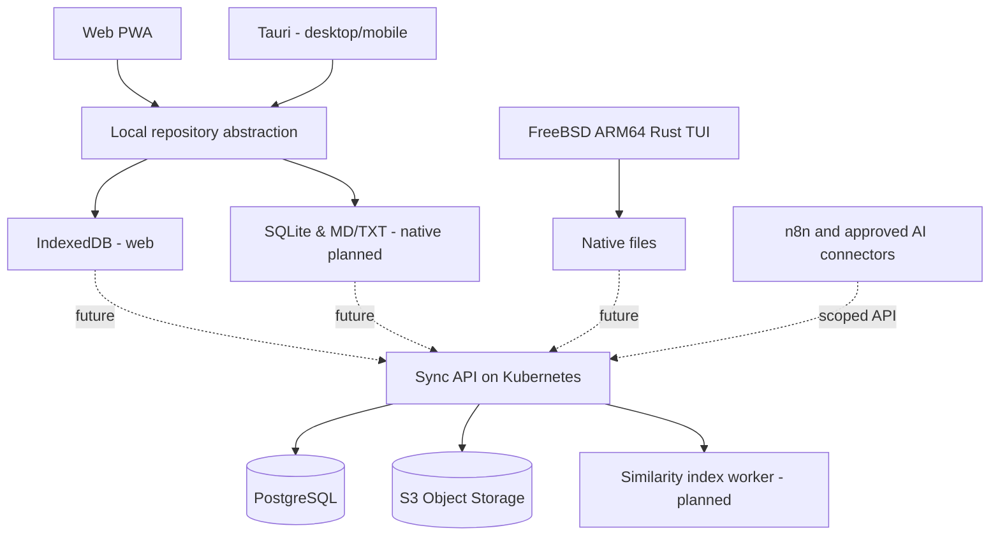

# 02. 전체 구조

## 원칙
- 데이터 소유권: 앱이 없어도 MD/TXT를 읽을 수 있는 파일 형식으로 유지.
- 온라인이 아니어도 메모 작성 가능. 계정 서버는 작성의 필수 의존성이 아님.
- 공통 UI와 원격 프로토콜 공유; FreeBSD는 별도 Rust 구현.
- 브라우저는 IndexedDB를 이용하고 파일 다운로드 제공. 네이티브는 추후 실 파일 시스템 + SQLite로 매핑.

## 경계
1. Editor UI: 편집/화면 전환/사용자 입력
2. Storage adapters: Browser IndexedDB / OS filesystem / BSD filesystem
3. Sync protocol: 의도/변경 버전 추적, 승인 후 lease 도입
4. API server: 인증, 저장소 사용량, 동기화, n8n 범위 제한
5. Async indexer: 변경 이벤트 기반 유사 메모 검색

## 저장소 어댑터 (로드맵 03단계 구현)
- 화면은 `NoteRepository` 인터페이스(`apps/web/src/storage/repository.ts`)만 사용.
  - 브라우저: IndexedDB 어댑터 / 데스크톱(Tauri): 파일 어댑터 → Rust 명령 → `crates/core::workspace::Workspace`.
  - 두 어댑터는 같은 계약 테스트(`repository.test.ts`)를 통과.
- `Workspace` = `FileStore`(.md/.txt 정본) + SQLite 보조 인덱스(`db/sqlite/001~003`, `PRAGMA user_version`으로 순서 적용).

## 권장 저장 방식
- Native 저장소의 **정본**은 사람이 볼 수 있는 `Notes/<0~2 folders>/<note>.md`.
- SQLite는 ID↔경로 인덱스, 세션 시간, change log, Undo diff, sync cursor 캐시.
- `sync sidecar`의 해시/버전은 사용자 텍스트 파일에 넣지 않고 로컬 DB에 둡니다.
- 노트 경로 이동 시 UUID는 유지하고 파일 경로만 변경.
- 충돌 시 원본을 삭제하지 않으며 서버/로컬 양쪽 사본을 보존.
